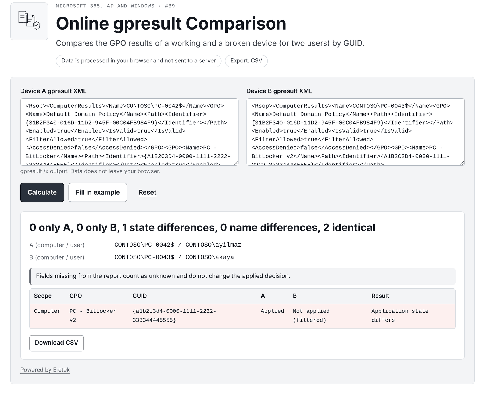

# gpresult Comparison

Compare two gpresult /x XML outputs: applied and filtered GPOs, computer and user scope, name changes under the same GUID. Tell a broken device from a healthy one.

## Try it live

- [Türkçe](https://sistem.eretek.com/araclar/gpresult-karsilastirma)
- [English](https://sistem.eretek.com/en/tools/gpresult-comparison)
- [Deutsch](https://sistem.eretek.com/de/werkzeuge/gpresult-vergleich)



## What it does

Compares the GPO results of a working and a broken device (or two users) by GUID.

The answer to 'this setting applies on one computer but not the other' is usually in the gpresult report: the GPO was security-filtered, rejected by a WMI filter or never linked. The tool matches two `gpresult /x` XMLs by GPO identity and shows differences in application state with the reason.

## Where it helps

'Filtered' means security or WMI filter; 'access denied' means missing read/apply permission. Check the Scope tab and Delegation permissions in GPMC.

## How to use it

1. On both devices run `gpresult /scope computer /x a.xml` from an elevated prompt (`/scope user` for users, or both).
2. Paste the XML contents into the two fields and press Calculate.

### Fields

| Field | Description |
|---|---|
| Device A gpresult XML | gpresult /x output. Data does not leave your browser. |
| Device B gpresult XML |  |

## Example input

Press **Fill in example** in the tool to load this input.

**Device A gpresult XML**

```text
<Rsop><ComputerResults><Name>CONTOSO\PC-0042$</Name><GPO><Name>Default Domain Policy</Name><Path><Identifier>{31B2F340-016D-11D2-945F-00C04FB984F9}</Identifier></Path><Enabled>true</Enabled><IsValid>true</IsValid><FilterAllowed>true</FilterAllowed><AccessDenied>false</AccessDenied></GPO><GPO><Name>PC - BitLocker</Name><Path><Identifier>{A1B2C3D4-0000-1111-2222-333344445555}</Identifier></Path><Enabled>true</Enabled><IsValid>true</IsValid><FilterAllowed>true</FilterAllowed><AccessDenied>false</AccessDenied></GPO></ComputerResults><UserResults><Name>CONTOSO\ayilmaz</Name><GPO><Name>U - Sürücü Eşleme</Name><Path><Identifier>{B1B2C3D4-0000-1111-2222-333344445555}</Identifier></Path><Enabled>true</Enabled><IsValid>true</IsValid><FilterAllowed>true</FilterAllowed><AccessDenied>false</AccessDenied></GPO></UserResults></Rsop>
```

**Device B gpresult XML**

```text
<Rsop><ComputerResults><Name>CONTOSO\PC-0043$</Name><GPO><Name>Default Domain Policy</Name><Path><Identifier>{31B2F340-016D-11D2-945F-00C04FB984F9}</Identifier></Path><Enabled>true</Enabled><IsValid>true</IsValid><FilterAllowed>true</FilterAllowed><AccessDenied>false</AccessDenied></GPO><GPO><Name>PC - BitLocker v2</Name><Path><Identifier>{A1B2C3D4-0000-1111-2222-333344445555}</Identifier></Path><Enabled>true</Enabled><IsValid>true</IsValid><FilterAllowed>false</FilterAllowed><AccessDenied>false</AccessDenied></GPO></ComputerResults><UserResults><Name>CONTOSO\akaya</Name><GPO><Name>U - Sürücü Eşleme</Name><Path><Identifier>{B1B2C3D4-0000-1111-2222-333344445555}</Identifier></Path><Enabled>true</Enabled><IsValid>true</IsValid><FilterAllowed>true</FilterAllowed><AccessDenied>false</AccessDenied></GPO></UserResults></Rsop>
```

**Expected result:** The BitLocker GPO (same GUID) applies on A but is security-filtered on B, and its name changed. Default Domain Policy and the user GPO are identical.

## Method and assumptions

GPO elements under ComputerResults and UserResults are read from each XML; identity is the Path/Identifier GUID. Applied = Enabled true, IsValid true, FilterAllowed true and AccessDenied false.

Both sides are compared per scope and GUID: GPOs on one side only, changed application state and name-only changes are listed separately.

## Limits and common mistakes

- Individual settings (registry, security settings) are not compared; it works at GPO level.
- Fields not recognized in the report are not interpreted; missing fields do not prevent 'applied'.

## Run it locally

The tool is plain HTML, CSS and JavaScript with no build step and no dependencies.

```bash
git clone https://github.com/eretek/gpresult-comparison.git
cd gpresult-comparison
node scripts/serve.js        # or: python3 -m http.server 8080
```

Open <http://127.0.0.1:8080/>. Add `?lang=tr` or `?lang=de` for Turkish or German; without it the page follows the browser language and falls back to English. You can also open `index.html` directly from disk.

Run the tests (Node.js 18 or later):

```bash
node test/run.js    # or: npm test
```

The tests run the tool's own fixtures and the worked examples in all three languages without a browser.

## How it works

All processing happens in your browser. The tool makes no network requests, uses no cookies or browser storage, and does not upload files you select.

No server-side component is needed. The version on the Eretek website renders the same page through a private WordPress plugin; that plugin only produces the page markup and is not part of this repository.

| Path | Purpose |
|---|---|
| `index.html` | Page shell |
| `src/app.js` | Builds the page in Turkish, English or German from `src/data.js` |
| `src/data.js` | Field definitions, examples and all texts in three languages |
| `src/core.js` | Shared runtime: validation, number formats, result rendering, CSV/ICS export |
| `src/tool.js` | The calculation or analysis for this tool |
| `docs/screenshot.png` | Screenshot used in this README |
| `src/lib/xml.js` | Safe minimal XML parser (no DTD, no external entities) |
| `src/tools.css`, `src/page.css` | Styles |
| `test/run.js`, `test/cases.json` | Headless tests |

## License and attribution

This tool is released under the [Eretek Website Attribution License](LICENSE). You may use, modify and redistribute it, including commercially. If you make it available on a website or web application, show a visible, clickable credit linking to https://eretek.com/ on every page where the tool is available, for example:

```html
<a href="https://eretek.com/">Powered by Eretek</a>
```

You may add `rel="nofollow"` to the link. Keep the copyright notice and license text in copies and redistributions.
